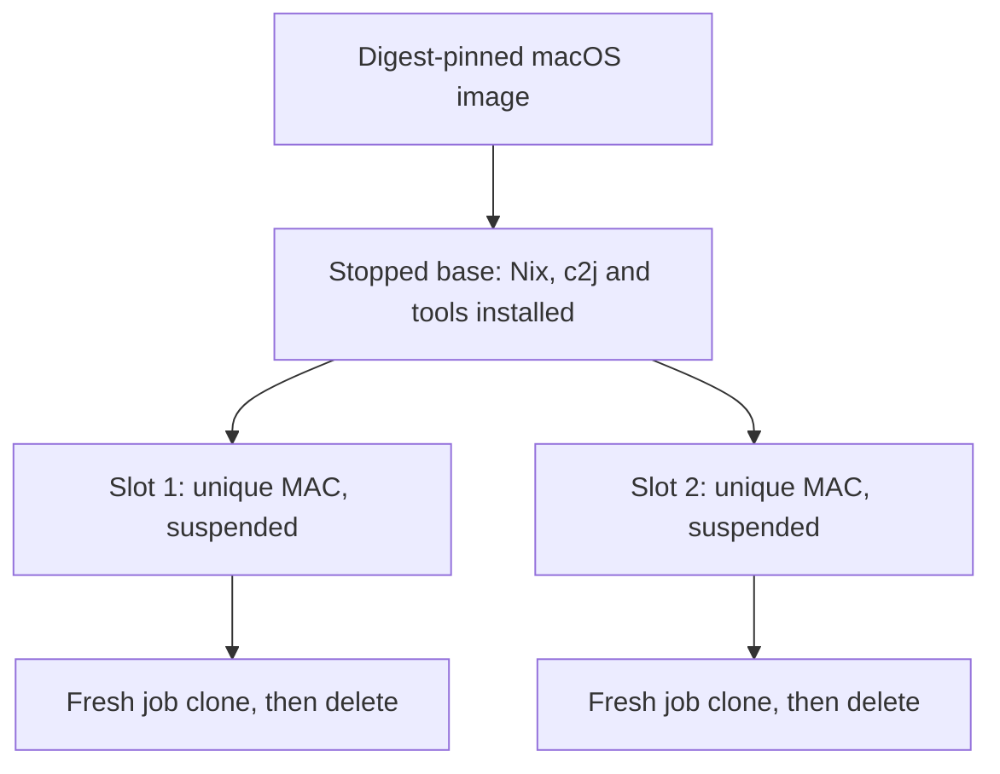

# macOS image lifecycle

The library and standalone updater use the same guest preparation scripts. Both produce a stopped prepared base and independently booted, suspended slot templates. Jobs always run in fresh clones.

## Initial preparation

The caller supplies bases, slot counts/sizes, an owner and durable state. Constructors perform no preparation; `Run`/`Reconcile` adopts existing named sources or prepares missing ones. The first install resolves `Config.C2JVersion` (`latest` by default) to a commit and uses Nix inside the guest to install c2j, the guest launcher, Git, Node/pnpm, uv and Python. Separate slots clone that shared prepared disk, configure their own CPU/memory/MAC, boot, verify tools/OS and suspend.

The transferred setup archive contains scripts and build definitions, not binaries or a VM image. It is an internal delivery mechanism that lets an application use the library without a repository checkout. There is no public bundle configuration and no c2j version compiled into the library.

## Job execution

Admission reserves a slot durably, clones its suspended source and resumes the clone. The guest checks the saved boot UUID/MAC against its actual identity before accepting the lease. It invokes the installed launcher and c2j with the concrete execution base and actual resources. It performs no installation or release lookup.

The unprivileged c2j process receives the lease through stdin and uses it to retrieve secrets. A small guest launcher records execution intent so delivery retries cannot execute the same launch twice. launchd owns the service independently of SSH; the guest shuts down when c2j exits. Reconciliation deletes the exact owned, stopped clone and makes the slot available again.

## Updating without a Pulse release

Run [the local Tart updater](prepared-images.md) on the worker. It builds a fresh base plus suspended slots, then replaces the published sources under the same names. Names identify owner/base/group/size/slot, never a c2j version. Each replacement has a fresh MAC. Existing clones retain their old environment; subsequent clones use the replacement.

No release manifest, installed-version metadata, or Pulse RPC coordinates this. `c2j version` reports what is installed. Changing a library version or `C2JVersion` does not refresh existing sources. An explicit update does. Publication is atomic with respect to Tart cloning for each individual source; it is not atomic across the whole pool.

Direct Tart permits replacement of these published source directories while retaining strict identity checks on job directories. Orchard uses its existing API records and worker-local suffixed names; the updater replaces matching native aliases. Remote Orchard fleet orchestration is deferred.

## Retention and recovery

`Close` preserves native resources. `Drain` stops admissions and releases slots after active work completes, keeping images for reuse. `PurgeImages` explicitly removes known, stopped sources after draining. Images not recorded in the runtime's journal, including extra canonical aliases, are outside that operation.

The durable journal handles ownership, reservations, uncertain dispatches and duplicate launches. It is not a software release manifest. Never discard it to retry an uncertain launch. Failed builders remain inspectable; unknown dispatches retain reservations. There is no attempt to clean an executed VM for another job.
